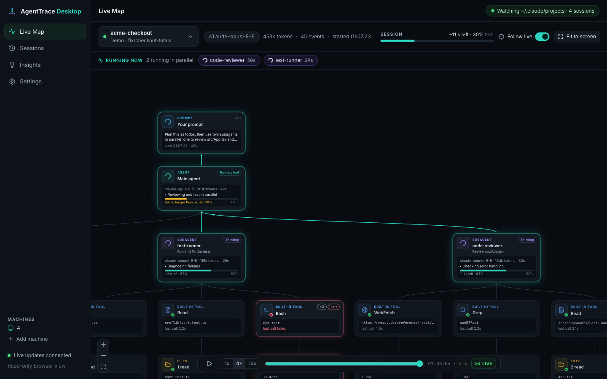

# AgentTrace Desktop

**See live what your Claude Code agents are doing.** An open source, local-first app for macOS, Windows and Linux that
turns Claude Code's own logs into a live map: your prompt, the main agent, its subagents, the tools they call and the
files they touch, with what is running in parallel, progress and an ETA. Your data never leaves your machine.



- **Live Map**: prompt → main agent → subagents → tools → resources, with glowing running cards, a "Running now" bar,
  progress and ETA per agent, and finished subagents folded into one chip.
- **Background work done right**: agents and commands that Claude Code runs in the background stay "running" until they
  really report back (or are stopped with `TaskStop`).
- **Sessions and replay**: every session on this machine, and a slider to rebuild the map at any earlier moment. The
  map stays where you leave it; **Center** brings everything back into view. Each agent's tools are grouped into one
  card (click it to open them, or **Show all tools**), so big sessions stay readable.
- **Several CLIs on one map**: running an orchestrator with many agents on one project? Put their sessions on one
  map from the session picker (**+**, or "Add … other sessions"). A **Team Live Map** across people and machines is
  coming.
- **Explain**: any session turn by turn (what you asked, which subagents and tools ran, files changed, commands, how it
  ended), plus an optional plain-language walkthrough from your AI model.
- **Insights**: a prompt coach that shows which of your prompts the agent found unclear, why, and how to write them
  better; which subagents to run (Explore, reviewers, test runners, parallel work); free local rules (repeated
  commands, error rates, huge steps, your "no"/"stop" corrections…), a usage profile, and optional AI coaching from the
  model _you_ choose, also for instruction files you pick (CLAUDE.md, agents, slash commands, prompt templates).
- **Notes**: a notes folder per user (goals, how you like to work, lessons). The AI coach reads it and keeps a
  `_learnings.md` about you, so its advice gets more personal over time.
- **Remote viewing**: read-only, token-protected access from your phone or another computer, ideally over Tailscale.

> The name "AgentTrace Desktop" is provisional.

## Download

Get the latest installer from the [Releases page](../../releases): `.dmg` (macOS, Apple Silicon + Intel), `.exe`
(Windows x64/arm64), `.AppImage` or `.deb` (Linux).

The builds are not code-signed yet, so the first launch needs one extra step:

- **macOS**: open the `.dmg`, drag AgentTrace to Applications, then right-click the app → **Open** → **Open**. (Or run
  `xattr -dr com.apple.quarantine /Applications/AgentTrace.app`.) Unsigned macOS builds can't update themselves; the app
  tells you when a new version is out and links to the download.
- **Windows**: SmartScreen says "Windows protected your PC" → **More info** → **Run anyway**.
- **Linux**: `chmod +x AgentTrace-*.AppImage && ./AgentTrace-*.AppImage`, or `sudo apt install ./AgentTrace-*.deb`.

AgentTrace lives in the tray / menu bar: closing the window keeps it watching. Use **Pause watching** or **Quit** there.

## Run from source

Needs Node.js 22.12+.

```bash
git clone https://github.com/KacperDula/AgentHub && cd AgentHub
npm install
npm run dev
```

The app opens and starts watching `~/.claude/projects` (it imports the last 24 hours on first run). No sessions yet? Click
**Load demo session** for a scripted run with two parallel subagents, failing tests and an MCP call. `npm test` runs the
test suite; see [CONTRIBUTING.md](CONTRIBUTING.md) and [docs/ARCHITECTURE.md](docs/ARCHITECTURE.md).

## Remote viewing with Tailscale

By default the local server listens on `127.0.0.1:8787` only. To watch from elsewhere:

1. Settings → **Remote viewing** → on. AgentTrace creates an access token and shows a QR code and the URLs that work.
2. Install [Tailscale](https://tailscale.com) on this computer and on your phone/laptop, logged in to the same account.
3. Open `http://<machine-name>:8787` (or scan the QR) and sign in with the token. For HTTPS run
   `tailscale serve 8787` and use the address it prints.

The browser view is read-only by design: no endpoint changes data or runs commands. **Revoke all browsers** makes a new
token and signs every browser out. Several computers? Run AgentTrace on each and add them under **Machines** in the
sidebar; each keeps its own data and login.

## AI suggestions (optional)

Settings → **AI provider**: _None_ (default, rules only), _Claude Code on this machine_ (`claude -p` with your login),
_Anthropic API_ (your key and model) or an _OpenAI-compatible endpoint_ (OpenRouter, Ollama, LM Studio). Keys are stored
in your OS keychain. When you press **Analyze**, only the rule signals, aggregate usage profile and a compact session
outline are sent (never file contents or tool outputs), and you see the exact payload first. Thumbs up/down on
suggestions feed into the next analysis.

## Privacy

- Everything is stored in a local SQLite file; nothing is sent anywhere unless you enable remote viewing or an AI provider.
- No accounts, no telemetry, no analytics.
- Retention (30 days by default) and **Delete all data** in Settings.

Details: [docs/PRIVACY.md](docs/PRIVACY.md).

## FAQ

**Does it change how I use Claude Code?** No. It only reads the transcript files Claude Code already writes.

**Agents that were running before I started AgentTrace are missing.** The first run imports the last 24 hours; change it
in Settings → Backfill. Files it has seen before continue where they stopped.

**Subagents show an id like "subagent a0a1e92".** Their spawn happened before the imported window. They are linked as
soon as the spawn or its result shows up.

**Why does the main agent say "taking longer than usual"?** ETAs are estimates from the plan's pace or from your past
subagents. While the main agent waits for subagents, its own plan doesn't advance.

**It stopped understanding my logs after a Claude Code update.** The Claude Code log format is **not an official API**
and can change between versions. Please open an issue with an anonymized example line (see the bug template).

**Where is my data?** See [docs/PRIVACY.md](docs/PRIVACY.md#where-it-is-stored).

## License

[MIT](LICENSE). The software is provided "as is", without warranty.
